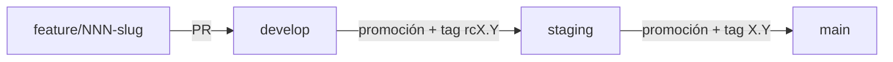

# 002-flujo-git-agentes — Flujo Git, workspaces de agentes y versionado

## Resumen

Define cómo se trabaja el repositorio: gitflow con tres ambientes, un workspace por spec con su propia rama, y versionado por tags `x.y` ligado al id de la spec. Inicializa `CLAUDE.md` con estas reglas para que los agentes las sigan.

Repositorio: https://github.com/DavidSlva/financial-risk-manager

## Alcance

**Incluye:** ramas y ambientes, nomenclatura, regla de workspaces, tags de promoción, `CLAUDE.md` inicial.
**No incluye:** CI/CD, protección de ramas en GitHub, hotfixes (ver "Puntos abiertos").

## Requisitos

- RF-1: Ramas permanentes: `main` (producción), `staging` (certificación), `develop` (desarrollo).
- RF-2: Cada spec se desarrolla en `feature/<NNN-slug>` (mismo id que la spec; ej. `feature/002-flujo-git-agentes`), creada desde `develop`.
- RF-3: Cada agente trabaja en un **workspace** (git worktree) con su propia rama. **Nunca** hay dos workspaces para la misma spec.
- RF-4: Se permiten **workspaces de integración** (rama `integration/<slug>`) para combinar cambios de varias specs antes de promover.
- RF-5: Cada promoción lleva un tag anotado `x.y`: `x` = id numérico de la spec, `y` = contador de actualizaciones sobre esa spec.
- RF-6: Promoción `develop → staging` usa tag con prefijo `rc` (`rcx.y`). Promoción `staging → main` usa el mismo número sin prefijo (`x.y`).
- RF-7: `CLAUDE.md` en la raíz contiene estas reglas y la metodología SDD/RPI.

## Modelo de ramas y promoción

| Rama               | Ambiente          | Entra desde                  | Tag     |
| ------------------ | ----------------- | ---------------------------- | ------- |
| `feature/NNN-slug` | local / workspace | `develop`                    | —       |
| `develop`          | desarrollo        | `feature/*`, `integration/*` | —       |
| `staging`          | certificación     | `develop`                    | `rcX.Y` |
| `main`             | producción        | `staging`                    | `X.Y`   |

## Versionado

- Formato `x.y`, ej. spec 2 → `2.0`, luego `2.1`, `2.2`…; en staging `rc2.0`, `rc2.1`…
- El tag va sobre el commit de promoción (el commit que deja la rama destino en el estado promovido).
- Una promoción a `main` reutiliza el número ya probado en staging, solo sin `rc`.

## Workspaces

- Un workspace = un worktree + una rama, asignado a un agente.
- Unicidad: antes de crear un workspace para una spec, verificar que no exista (`git worktree list`, ramas `feature/<NNN-slug>`).
- Integración: `integration/<slug>` agrupa cambios de varias specs; no reemplaza la rama de la spec ni la hace duplicada.

## Documentos RPI

- Research (constitution): [../research/002-flujo-git-agentes/constitution.md](../research/002-flujo-git-agentes/constitution.md)
- Plan: [../plan/002-flujo-git-agentes/plan.md](../plan/002-flujo-git-agentes/plan.md)
- Tasks: [../implementation/002-flujo-git-agentes/tasks.md](../implementation/002-flujo-git-agentes/tasks.md)
- Implement: [../implementation/002-flujo-git-agentes/implement.md](../implementation/002-flujo-git-agentes/implement.md)
- Prompt origen: [../prompts/2026-11-09_1913_002-flujo-git-agentes.md](../prompts/2026-11-09_1913_002-flujo-git-agentes.md)
- Resultado: [../../CLAUDE.md](../../CLAUDE.md)

## Specs relacionadas

- depende de: [001-setup-inicial](001-setup-inicial.md) — estructura de `docs/` y metodología.
- relacionada con: [003-tooling](003-tooling.md) — la convención de commits usa el id de spec como scope.

## Puntos abiertos

- **Primer `y`:** se asume que la primera promoción de una spec es `x.0`.
- **Promociones con varias specs** (workspace de integración): qué `x` lleva el tag. Pendiente de decidir.
- **Hotfix** sobre `main`: no definido; gitflow clásico usaría `hotfix/*`.
- **Protección de ramas / CI** en GitHub: fuera de alcance.

## Estado final (Converge)

Se creó `CLAUDE.md` con el flujo Git, reglas de workspaces, versionado y metodología. El repositorio quedó inicializado y conectado a `origin`: commit inicial `6cfcdb3` en `main`, con `staging` y `develop` creadas desde él y publicadas. No se crearon tags (aún no hay promoción formal). Las specs 001 y 002 entraron en ese commit inicial sin pasar por `feature/*`.

**Revisión de documentos relacionados:**

- [x] constitution actualizada
- [x] plan actualizado
- [x] tasks actualizadas
- [x] implement actualizado
- [x] specs relacionadas revisadas (001 enlaza a 002)
- [x] índice `specs/README.md` actualizado
