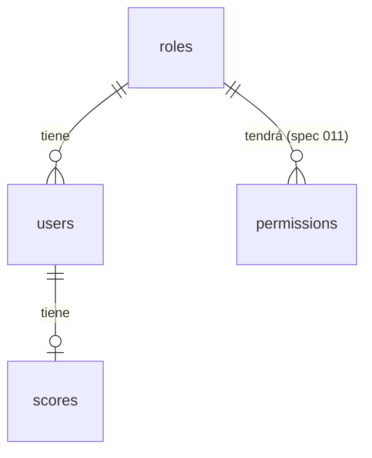

# 006-modelo-datos — Modelo de datos base

## Resumen

La app devuelve un **score financiero asociado a un rut**. No hay base de datos: los datos viven en archivos JSON. Esta spec define su modelo con mentalidad SQL (claves primarias y foráneas, restricciones) y valida la **integridad referencial** al cargar. El modelo es mínimo a propósito.

El **rol** (nivel de privilegios dentro de la plataforma) es **extensible**, por eso tiene su **propio modelo** (`roles`) y no es una lista fija en el código. Sobre esa tabla se construirá después el RBAC ([011-rbac](011-rbac.md), pendiente).

## Alcance

**Incluye:** esquema de los tres archivos y la función de cada columna, reglas de integridad, validación al arranque y en recarga, servicios de lectura, datos de ejemplo.
**No incluye:** permisos por rol y su validación en el middleware ([011-rbac](011-rbac.md)), validación del formato del RUT ([008-validador-rut](008-validador-rut.md)), escritura de datos (los archivos se editan a mano), endpoints HTTP del score, autenticación ([007-auth-jwt](007-auth-jwt.md)).

## Modelo

Referencia en SQL (equivalente lógico; no hay motor SQL):

```sql
CREATE TABLE roles (
  name        TEXT PRIMARY KEY,
  description TEXT NOT NULL
);

CREATE TABLE users (
  rut    TEXT PRIMARY KEY,
  role   TEXT NOT NULL REFERENCES roles (name) ON DELETE RESTRICT,
  active BOOLEAN NOT NULL
);

CREATE TABLE scores (
  rut   TEXT PRIMARY KEY REFERENCES users (rut) ON DELETE RESTRICT,
  score INTEGER NOT NULL CHECK (score BETWEEN 0 AND 1000)
);
```



Relaciones: `roles 1 — 0..n users`, `users 1 — 0..1 scores`. Un rol puede no tener usuarios; un usuario puede no tener score aún; un score no puede existir sin usuario, ni un usuario sin un rol existente.

### Columnas y su función

**`roles`** — catálogo de niveles de privilegio. Agregar un rol es agregar una fila, sin cambiar código.

| Columna       | Tipo   | Nulo | Función                                                                                                |
| ------------- | ------ | ---- | ------------------------------------------------------------------------------------------------------ |
| `name`        | string | no   | Identificador del rol y **clave primaria** (`admin`, `user`). Es el valor que referencia `users.role`. |
| `description` | string | no   | Texto para humanos: qué nivel de privilegios representa. No participa en ninguna decisión de acceso.   |

**`users`** — personas que pueden usar la plataforma.

| Columna  | Tipo    | Nulo | Función                                                                                                                                                                            |
| -------- | ------- | ---- | ---------------------------------------------------------------------------------------------------------------------------------------------------------------------------------- |
| `rut`    | string  | no   | Identidad del usuario y **clave primaria**. Es el `sub` de los tokens ([007](007-auth-jwt.md)) y el vínculo con su score. Es opaco hasta [008](008-validador-rut.md).              |
| `role`   | string  | no   | **Nivel de privilegios** del usuario dentro de la plataforma. **Clave foránea** a `roles.name`: solo puede ser un rol que exista.                                                  |
| `active` | boolean | no   | **Marca de vigencia.** `true` = el usuario puede autenticarse y refrescar tokens; `false` = revocado. Es el mecanismo de revocación de [007](007-auth-jwt.md); rige sin reiniciar. |

**`scores`** — el dato que devuelve la app.

| Columna | Tipo    | Nulo | Función                                                                                            |
| ------- | ------- | ---- | -------------------------------------------------------------------------------------------------- |
| `rut`   | string  | no   | **Clave primaria y foránea** a `users.rut`: a quién pertenece el score (a lo más uno por usuario). |
| `score` | integer | no   | Score financiero del usuario, entero entre 0 y 100 (supuesto; ver puntos abiertos).                |

### Archivos

En `backend/data/` (ruta configurable con `DATA_DIR`):

`roles.json` (versionado: no contiene datos personales)

```json
[
  { "name": "admin", "description": "Administración de la plataforma" },
  { "name": "user", "description": "Consulta de su propio score" }
]
```

`users.json`

```json
[
  { "rut": "11111111-1", "role": "admin", "active": true },
  { "rut": "22222222-2", "role": "user", "active": false }
]
```

`scores.json`

```json
[{ "rut": "11111111-1", "score": 780 }]
```

## Reglas de integridad

| Id   | Regla                                                                                                | Equivalente SQL    |
| ---- | ---------------------------------------------------------------------------------------------------- | ------------------ |
| IR-1 | Cada archivo es un arreglo JSON de objetos                                                           | tabla              |
| IR-2 | Cada fila tiene exactamente sus columnas, con el tipo correcto (sin campos extra ni nulos)           | esquema / NOT NULL |
| IR-3 | `roles.name`, `users.rut`, `users.role`, `scores.rut`: string no vacío, sin espacios en los extremos | NOT NULL           |
| IR-4 | `roles.name` único                                                                                   | PRIMARY KEY        |
| IR-5 | `users.rut` único                                                                                    | PRIMARY KEY        |
| IR-6 | `scores.rut` único (un score por rut)                                                                | PRIMARY KEY        |
| IR-7 | `users.role` debe existir en `roles.name`                                                            | FOREIGN KEY        |
| IR-8 | `scores.rut` debe existir en `users.rut`                                                             | FOREIGN KEY        |
| IR-9 | `scores.score` es entero entre 0 y 100 (antes 0 y 1000; ver [013](013-consulta-score.md))            | CHECK              |

El formato del RUT (dígito verificador, normalización) no se valida aquí: lo cubre [008-validador-rut](008-validador-rut.md). Hasta entonces el rut es un identificador opaco (IR-3).

## Comportamiento

- **Arranque:** se leen y validan los tres archivos. Si alguna regla falla, el proceso aborta e informa **todas** las violaciones (archivo, fila, regla).
- **Recarga:** los archivos se vuelven a leer cuando cambia su fecha de modificación, para que un cambio de vigencia (`active`) rija sin reiniciar. Si el contenido nuevo no valida, se **falla cerrado**: se informa el error y se rechazan las operaciones que dependan de los datos, en lugar de usar datos inconsistentes.
- **Datos personales fuera del repositorio:** `backend/data/users.json` y `scores.json` se ignoran en git; se versionan `users.example.json` y `scores.example.json` con datos ficticios. `roles.json` sí se versiona.

## Documentos RPI

- Research (constitution): [../research/006-modelo-datos/constitution.md](../research/006-modelo-datos/constitution.md)
- Plan: [../plan/006-modelo-datos/plan.md](../plan/006-modelo-datos/plan.md)
- Tasks: [../implementation/006-modelo-datos/tasks.md](../implementation/006-modelo-datos/tasks.md)
- Implement: [../implementation/006-modelo-datos/implement.md](../implementation/006-modelo-datos/implement.md)
- Prompts origen: [../prompts/2026-11-09_2002_006-007-modelo-datos-y-auth.md](../prompts/2026-11-09_2002_006-007-modelo-datos-y-auth.md), [../prompts/2026-11-09_2013_010-tdd-vitest.md](../prompts/2026-11-09_2013_010-tdd-vitest.md)

## Specs relacionadas

- depende de: [005-backend-estructura](005-backend-estructura.md) — ubicación en capas (`services/`, `config/`).
- depende de: [010-tdd-vitest](010-tdd-vitest.md) — se implementa con TDD y Vitest.
- relacionada con: [007-auth-jwt](007-auth-jwt.md) — consume la vigencia del usuario.
- deriva en: [008-validador-rut](008-validador-rut.md) — validación del formato de RUT (pendiente).
- deriva en: [011-rbac](011-rbac.md) — permisos por rol (pendiente).

## Puntos abiertos

- Valores iniciales de `roles` (`admin`, `user`) y rango del score (0–1000): supuestos. Confirmar.
- Formato canónico del rut → 008.
- Estructura de `permissions` (clave–valor por rol) → 011.
- `DATA_DIR` por defecto: la carpeta `backend/data`.

## Estado final (Converge)

Implementado con TDD en `feature/006-modelo-datos` (workspace `D:\Persona-ws\006-modelo-datos`): las pruebas se escribieron primero y se confirmó que fallaban antes de implementar. Resultado: 65 pruebas en verde (52 nuevas), `eslint`, `tsc` y `prettier --check` sin errores.

Verificado a mano con el backend compilado: con datos válidos arranca y `GET /api/health` responde 200; con un `scores.json` inválido el proceso aborta con código 1 e informa IR-8 e IR-9; cambiar `active` en `users.json` se refleja en la siguiente lectura sin reiniciar.

Implementado:

- `DATA_DIR` en `config/environment.ts`; tipos en `models/data.types.ts` (carpeta nueva respecto a la spec 005, documentada en `backend/README.md`).
- `data-integrity.service.ts` (reglas IR-1…IR-9; no genera violaciones de clave foránea en cascada si la tabla padre es inutilizable), `data-store.service.ts` (caché por fecha de modificación y tamaño, falla cerrado, datos congelados) y servicios `roles`, `users` y `scores`.
- Carga y validación al arranque en `index.ts`; `roles.json` versionado y ejemplos de `users` y `scores`; datos personales en `.gitignore`.

Notas:

- No existe aún un script de compilación del backend. Para la verificación manual se compiló con `tsc --outDir dist --rootDir .` y se ejecutó con `DATA_DIR`; los scripts `build` y `start` siguen pendientes (spec posterior).
- Los servicios aceptan un almacén por parámetro (por defecto el de la aplicación) para poder probarse con carpetas temporales.
- Evolución posterior: la spec [011](011-rbac.md) agregó la tabla `permissions` (`role`, `key`, `value`; clave primaria `(role, key)`, clave foránea a `roles`, catálogo cerrado en código) y las reglas IR-10…IR-12; `permissions.json` se versiona y forma parte de los datos validados.
- Evolución posterior ([009](009-emision-tokens.md)): `users` ganó `password_hash` (hash scrypt) y `failed_attempts` (contador de intentos fallidos), con IR-14 (formato del hash) e IR-15 (entero ≥ 0). **El backend ahora escribe `users.json`** (solo `failed_attempts`), de forma atómica y validada, a través de `data-store.updateUsers`; ya no es cierto que los archivos solo se editen a mano. `users.json` guarda secretos (hashes) y sigue fuera de git.
- Evolución posterior: la spec [008](008-validador-rut.md) agregó IR-13 (`users.rut` y `scores.rut` con formato canónico `12345678-5` y dígito verificador válido).

**Revisión de documentos relacionados:**

- [x] constitution actualizada
- [x] plan actualizado
- [x] tasks actualizadas
- [x] implement actualizado
- [x] specs relacionadas revisadas (007 consume `active`; 008 y 011 siguen pendientes)
- [x] índice `specs/README.md` actualizado
