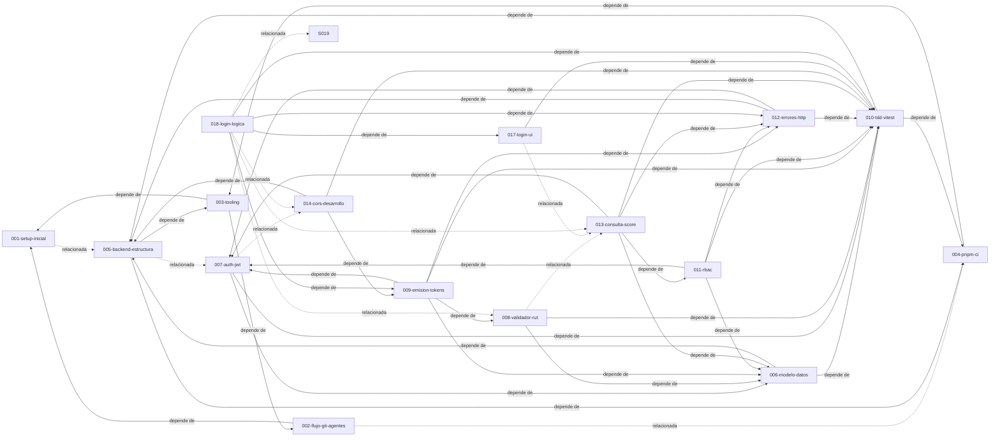

# Índice de Specs

Cada spec es un nodo del grafo. Las relaciones se declaran en el front matter de cada spec y se resumen aquí.

| ID                                                  | Título                                                                                   | Estado       | Depende de              | Relacionada con    | Research                                                           | Plan                                           | Implementation                                                                                                                  |
| --------------------------------------------------- | ---------------------------------------------------------------------------------------- | ------------ | ----------------------- | ------------------ | ------------------------------------------------------------------ | ---------------------------------------------- | ------------------------------------------------------------------------------------------------------------------------------- |
| [001-setup-inicial](001-setup-inicial.md)           | Setup inicial del monorepo y metodología                                                 | converged    | —                       | 002, 003, 005      | [constitution](../research/001-setup-inicial/constitution.md)      | [plan](../plan/001-setup-inicial/plan.md)      | [tasks](../implementation/001-setup-inicial/tasks.md) · [implement](../implementation/001-setup-inicial/implement.md)           |
| [002-flujo-git-agentes](002-flujo-git-agentes.md)   | Flujo Git, workspaces de agentes y versionado                                            | converged    | 001                     | 003, 004           | [constitution](../research/002-flujo-git-agentes/constitution.md)  | [plan](../plan/002-flujo-git-agentes/plan.md)  | [tasks](../implementation/002-flujo-git-agentes/tasks.md) · [implement](../implementation/002-flujo-git-agentes/implement.md)   |
| [003-tooling](003-tooling.md)                       | Tooling de calidad (Node, Prettier, ESLint, tsc, Commitlint, hooks)                      | converged    | 001, 002                | 004                | [constitution](../research/003-tooling/constitution.md)            | [plan](../plan/003-tooling/plan.md)            | [tasks](../implementation/003-tooling/tasks.md) · [implement](../implementation/003-tooling/implement.md)                       |
| [004-pnpm-ci](004-pnpm-ci.md)                       | pnpm, política de cadena de suministro y CI en GitHub                                    | converged    | 003                     | 002, 010           | [constitution](../research/004-pnpm-ci/constitution.md)            | [plan](../plan/004-pnpm-ci/plan.md)            | [tasks](../implementation/004-pnpm-ci/tasks.md) · [implement](../implementation/004-pnpm-ci/implement.md)                       |
| [005-backend-estructura](005-backend-estructura.md) | Estructura del backend (Express, capas y Feature-Driven Separation)                      | converged    | 003, 004                | 001, 007           | [constitution](../research/005-backend-estructura/constitution.md) | [plan](../plan/005-backend-estructura/plan.md) | [tasks](../implementation/005-backend-estructura/tasks.md) · [implement](../implementation/005-backend-estructura/implement.md) |
| [006-modelo-datos](006-modelo-datos.md)             | Modelo de datos base (roles, users, scores) e integridad referencial                     | converged    | 005, 010                | 007                | [constitution](../research/006-modelo-datos/constitution.md)       | [plan](../plan/006-modelo-datos/plan.md)       | [tasks](../implementation/006-modelo-datos/tasks.md) · [implement](../implementation/006-modelo-datos/implement.md)             |
| [007-auth-jwt](007-auth-jwt.md)                     | Autenticación JWT simétrica con access/refresh y revocación por vigencia                 | converged    | 006, 010                | 005, 014           | [constitution](../research/007-auth-jwt/constitution.md)           | [plan](../plan/007-auth-jwt/plan.md)           | [tasks](../implementation/007-auth-jwt/tasks.md) · [implement](../implementation/007-auth-jwt/implement.md)                     |
| [008-validador-rut](008-validador-rut.md)           | Validador del formato de RUT (formato canónico 12345678-5)                               | converged    | 006, 010                | 009, 013           | [constitution](../research/008-validador-rut/constitution.md)      | [plan](../plan/008-validador-rut/plan.md)      | [tasks](../implementation/008-validador-rut/tasks.md) · [implement](../implementation/008-validador-rut/implement.md)           |
| [009-emision-tokens](009-emision-tokens.md)         | Login con contraseña y emisión del primer par de tokens                                  | converged    | 006, 007, 008, 010, 012 | —                  | [constitution](../research/009-emision-tokens/constitution.md)     | [plan](../plan/009-emision-tokens/plan.md)     | [tasks](../implementation/009-emision-tokens/tasks.md) · [implement](../implementation/009-emision-tokens/implement.md)         |
| [012-errores-http](012-errores-http.md)             | Mapa de errores HTTP en config y manejador de errores único                              | converged    | 005, 007, 010           | 011, 013           | [constitution](../research/012-errores-http/constitution.md)       | [plan](../plan/012-errores-http/plan.md)       | [tasks](../implementation/012-errores-http/tasks.md) · [implement](../implementation/012-errores-http/implement.md)             |
| [013-consulta-score](013-consulta-score.md)         | Consulta de score por rut con autorización personalizada                                 | converged    | 006, 007, 010, 011, 012 | 008                | [constitution](../research/013-consulta-score/constitution.md)     | [plan](../plan/013-consulta-score/plan.md)     | [tasks](../implementation/013-consulta-score/tasks.md) · [implement](../implementation/013-consulta-score/implement.md)         |
| [014-cors-desarrollo](014-cors-desarrollo.md)       | CORS para desarrollo (front en localhost:3000, back en localhost:8000)                   | converged    | 005, 009, 010           | 007                | [constitution](../research/014-cors-desarrollo/constitution.md)    | [plan](../plan/014-cors-desarrollo/plan.md)    | [tasks](../implementation/014-cors-desarrollo/tasks.md) · [implement](../implementation/014-cors-desarrollo/implement.md)       |
| [010-tdd-vitest](010-tdd-vitest.md)                 | TDD con Vitest (test/ espejo de src/) e integración en el CI                             | converged    | 004, 005                | 006, 007           | [constitution](../research/010-tdd-vitest/constitution.md)         | [plan](../plan/010-tdd-vitest/plan.md)         | [tasks](../implementation/010-tdd-vitest/tasks.md) · [implement](../implementation/010-tdd-vitest/implement.md)                 |
| [011-rbac](011-rbac.md)                             | RBAC simple con permisos personalizados y middleware de autorización                     | converged    | 006, 007, 010, 012      | 013                | [constitution](../research/011-rbac/constitution.md)               | [plan](../plan/011-rbac/plan.md)               | [tasks](../implementation/011-rbac/tasks.md) · [implement](../implementation/011-rbac/implement.md)                             |
| [017-login-ui](017-login-ui.md)                     | Diseño de la pantalla de login (mobile first, tema oscuro, config de estilos)            | implementing | 010                     | 018, 013           | [constitution](../research/017-login-ui/constitution.md)           | [plan](../plan/017-login-ui/plan.md)           | —                                                                                                                               |
| [018-login-logica](018-login-logica.md)             | Lógica del login (validación, `/api/auth/login`, sesión por cookies, errores por status) | implementing | 009, 010, 012, 017      | 013, 019, 008, 014 | [constitution](../research/018-login-logica/constitution.md)       | [plan](../plan/018-login-logica/plan.md)       | [tasks](../implementation/018-login-logica/tasks.md) · [implement](../implementation/018-login-logica/implement.md)             |

Estados: `draft` → `specified` → `planned` → `tasked` → `implementing` → `converged`.

## Grafo

