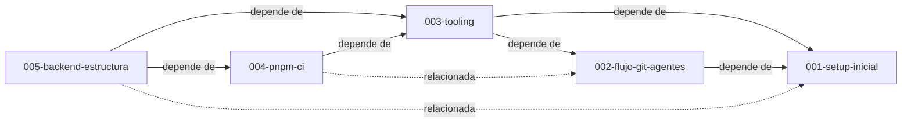

# Índice de Specs

Cada spec es un nodo del grafo. Las relaciones se declaran en el front matter de cada spec y se resumen aquí.

| ID                                                  | Título                                                              | Estado    | Depende de | Relacionada con | Research                                                           | Plan                                           | Implementation                                                                                                                  |
| --------------------------------------------------- | ------------------------------------------------------------------- | --------- | ---------- | --------------- | ------------------------------------------------------------------ | ---------------------------------------------- | ------------------------------------------------------------------------------------------------------------------------------- |
| [001-setup-inicial](001-setup-inicial.md)           | Setup inicial del monorepo y metodología                            | converged | —          | 002             | [constitution](../research/001-setup-inicial/constitution.md)      | [plan](../plan/001-setup-inicial/plan.md)      | [tasks](../implementation/001-setup-inicial/tasks.md) · [implement](../implementation/001-setup-inicial/implement.md)           |
| [002-flujo-git-agentes](002-flujo-git-agentes.md)   | Flujo Git, workspaces de agentes y versionado                       | converged | 001        | —               | [constitution](../research/002-flujo-git-agentes/constitution.md)  | [plan](../plan/002-flujo-git-agentes/plan.md)  | [tasks](../implementation/002-flujo-git-agentes/tasks.md) · [implement](../implementation/002-flujo-git-agentes/implement.md)   |
| [003-tooling](003-tooling.md)                       | Tooling de calidad (Node, Prettier, ESLint, tsc, Commitlint, hooks) | converged | 001, 002   | —               | [constitution](../research/003-tooling/constitution.md)            | [plan](../plan/003-tooling/plan.md)            | [tasks](../implementation/003-tooling/tasks.md) · [implement](../implementation/003-tooling/implement.md)                       |
| [004-pnpm-ci](004-pnpm-ci.md)                       | pnpm, política de cadena de suministro y CI en GitHub               | converged | 003        | 002             | [constitution](../research/004-pnpm-ci/constitution.md)            | [plan](../plan/004-pnpm-ci/plan.md)            | [tasks](../implementation/004-pnpm-ci/tasks.md) · [implement](../implementation/004-pnpm-ci/implement.md)                       |
| [005-backend-estructura](005-backend-estructura.md) | Estructura del backend (Express, capas y Feature-Driven Separation) | converged | 003, 004   | 001             | [constitution](../research/005-backend-estructura/constitution.md) | [plan](../plan/005-backend-estructura/plan.md) | [tasks](../implementation/005-backend-estructura/tasks.md) · [implement](../implementation/005-backend-estructura/implement.md) |

Estados: `draft` → `specified` → `planned` → `tasked` → `implementing` → `converged`.

## Grafo

